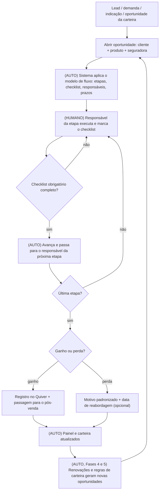
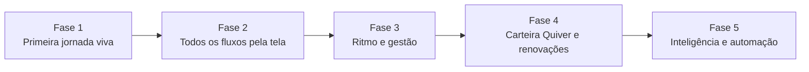

# Escopo Definitivo — Central do Fluxo Comercial N&G

> **Projeto:** Inteligência Comercial e Expansão da Carteira
> **Cliente:** Nunes & Grossi Corretora de Seguros (N&G Corretora) — Santos/SP
> **Consultora técnica:** Kimberly Prestes (Adapta Labs Native)
> **Versão:** 1.1 — para validação do cliente · **Data:** 16/10/2026
> **Ciclo do programa:** 15/09/2026 a 15/01/2027 (4 meses de consultoria)
> **Nome do sistema:** “Central do Fluxo Comercial N&G” (nome provisório, pode ser trocado)
> **Tecnologia:** Skip (telas) + Supabase (banco de dados, arquivos e automações), com dados hospedados em São Paulo

---

## Como ler este documento

Este é o documento “mãe” do projeto. Ele explica, em linguagem de negócio, **o que vamos
construir, para quem, em que ordem e como vamos saber que deu certo**.

- As partes técnicas (especificações e tarefas que o Maestro executa) saem **deste** documento,
  fase por fase. Vocês não precisam ler essas partes técnicas, só este escopo.
- Os pontos marcados com **[VALIDAR D-xx]** são decisões que precisam da resposta de vocês. A lista
  completa está na seção 14. Respostas curtas no grupo do WhatsApp já bastam.
- Pedimos que leiam e apontem **o que querem diferente, o que falta e o que não faz sentido**. Depois
  dessa rodada, o escopo é congelado e liberamos a Fase 1.

### O que mudou em relação à primeira versão do escopo

A primeira versão (`01-Escopo.md`) tratava principalmente do **motor de cross-sell** (descobrir
qual cliente da carteira abordar com qual produto). Na 1ª consultoria (05/10/2026) alinhamos que,
**antes** dessa inteligência, a N&G precisa da **fundação**: um sistema único em que cada
oportunidade segue o fluxo certo da seguradora ou operadora, com checklist, responsáveis, prazos e
passagem de bastão entre pessoas. A inteligência de carteira continua no projeto, na Fase 5,
apoiada sobre a fundação e sobre a integração com o Quiver.

### Como as fases foram pensadas

Cada fase entrega **um pedaço do sistema funcionando de ponta a ponta**, não uma “camada” isolada.
Já no fim da Fase 1 vocês abrem uma oportunidade real, veem o fluxo da operadora aparecer, marcam o
checklist, passam para outra pessoa e fecham a venda. As fases seguintes vão **dando forma** ao que
já existe: primeiro vocês ganham o controle dos fluxos pela tela, depois prazos e painel de gestão,
depois a carteira do Quiver e, por fim, a inteligência e as automações.

---

## 1. Resumo executivo

Hoje o processo comercial da N&G fica **picotado**: parte no celular de quem atende, parte no
WhatsApp, parte no Quiver PRO, parte em Excel, Word, PowerPoint, Bloco de Notas e Outlook. Não dá
para saber quantos leads entram, quantos viram proposta, quanto tempo cada etapa leva, onde se
perde venda e quais clientes da carteira poderiam comprar mais.

Vamos construir, no Skip com o Maestro, uma **central do fluxo comercial**. Na prática:

1. **Abriu uma oportunidade, o fluxo certo aparece sozinho.** Ao escolher cliente + produto +
   seguradora/operadora, o sistema monta as etapas, o checklist de documentos e informações, os
   responsáveis e os prazos daquele fluxo específico.
2. **Cada pessoa vê a sua fila.** Quando alguém conclui a sua parte, a oportunidade passa
   automaticamente para a próxima pessoa, que já recebe tudo o que precisa.
3. **Vocês mesmos editam os fluxos pela tela.** Incluir uma seguradora, mudar uma etapa ou um
   documento do checklist, ou copiar um fluxo e ajustá-lo para outra companhia, tudo sem mexer em
   código e sem risco de quebrar o sistema.
4. **A gestão enxerga o funil em tempo real**: conversão, tempo por etapa, oportunidades paradas,
   motivos de perda, por vendedor, produto e seguradora.
5. **Depois vêm a carteira, a inteligência e as automações:** conexão com o Quiver PRO (assim que a
   API individual for liberada), régua de renovação, identificação automática de oportunidades de
   cross-sell e up-sell e automações de coleta e cotação (formulário para o cliente enviar
   documentos, pedido de cotação por e-mail ou WhatsApp).

**O Quiver PRO continua sendo o sistema oficial de apólices, comissões e financeiro.** A central não
substitui o Quiver; ela organiza o caminho comercial até lá e, depois da integração, lê os dados do
Quiver para conhecer a carteira.

---

## 2. Contexto do negócio (o que já sabemos)

| Tema | O que foi levantado | Fonte |
|---|---|---|
| Empresa | Corretora familiar com foco B2B; seguros de todos os ramos + planos de saúde e odonto; PF atendida de forma passiva. Reestruturação de 100 para cerca de 13 colaboradores. | Kickoff 15/09; DMO |
| Duas frentes regulatórias | **Seguros** (SUSEP) e **Saúde/Odonto** (ANS), com equipes separadas internamente. | 1ª consultoria 05/10 |
| Equipe comercial | 4 pessoas, cada uma com foco diferente de perfil de cliente ou de produto. | 1ª consultoria 05/10 |
| Pós-venda | Saúde: contato diário com o RH do cliente (movimentações, faturas, coparticipação) e renovações. Seguros: sinistros e renovações ainda com o comercial, em transição para o pós-venda. | Kickoff 15/09 |
| Captação | 100% orgânica: indicação de clientes, redes sociais/LinkedIn, parceiros e programa interno de indicação com comissão para colaboradores. | Kickoff 15/09 |
| Sistemas | Quiver PRO (gestão, multicálculo, comissões), QuiverZap (atendimento receptivo), SIMP (multicálculo de saúde), portais das seguradoras e operadoras, WhatsApp, pacote Microsoft. | Vídeos de mapeamento |
| Quiver e API | A N&G saiu do grupo de corretores (A12). Prazo de 30 a 45 dias, contado a partir do distrato, para a base ser isolada e a API própria ser liberada. A documentação da API (cerca de 80 a 100 páginas) já está com a N&G. | 1ª consultoria 05/10; kickoff |
| Indicadores hoje | Comercial: só meta/fechamento. Pós-venda: retenção. Não existe funil nem dashboard. | DMO; kickoff |
| Objetivo da empresa | Aumentar faturamento e volume de vendas, manter retenção e vender mais produtos para o mesmo cliente. | DMO |

### Jornadas mapeadas em vídeo (base dos fluxos piloto)

| # | Jornada | Seguradora/Operadora | Quem demonstrou | Particularidade principal |
|---|---|---|---|---|
| J1 | Auto/Moto individual (PF) | Porto Seguro (Corretor Online) | Carol | Condutor jovem muda o preço; desconto do cartão Porto Bank; alerta de chassi duplicado no Quiver. |
| J2 | RC Profissional (E&O), advogados (PJ) | Tokio Marine e Akad Digital | Sheyla | Questionário de risco; OAB de um sócio; cotação expira com a demora do cliente; assinatura digital obrigatória. |
| J3 | Seguro Empresarial | Porto Seguro (PortoPrint web) | Sheyla | Aluguel = 6× o aluguel mensal; Danos Morais ≤ 100% da RC; cláusula beneficiária em imóvel alugado. |
| J4 | RC Eventos | Porto Seguro | Sheyla | Contratado junto com o AP do mesmo evento; datas de montagem e desmontagem; descrição sem caracteres especiais. |
| J5 | AP Eventos (Vida Eventos) | Capemisa | Sheyla | Grupos seguráveis (participantes, expositores, staff); MA/IPA 100% e DMHO 10%; apólice só depois do pagamento. |
| J6 | Saúde PME 3 a 29 vidas | SulAmérica, Porto Saúde (via SIMP) | Isabelle | Comparativo multioperadora; checklist de implantação extenso; críticas da operadora; cancelamento do plano anterior só depois da implantação. |
| J7 | Saúde PME 30 a 99 vidas (venda perdida) | Ana Costa, Santa Saúde (via SIMP) | Isabelle | Censo por faixa etária da ANS; convenção coletiva (CCT); reunião presencial; follow-ups longos; perda registrada com motivo. |

> Pelo critério de volume e complexidade definido por vocês, estas 7 jornadas são o **piloto**.
> Como os fluxos serão editáveis pela tela (a partir da Fase 2), as demais combinações de produto ×
> seguradora vocês mesmos cadastram depois, copiando um fluxo parecido e ajustando.

---

## 3. Objetivo do sistema e critérios de sucesso

### Objetivo

Transformar o processo comercial da N&G em um **fluxo único, rastreável e configurável**, do lead
até a apólice registrada, e usar esse fluxo e a carteira do Quiver para **gerar, priorizar e
acompanhar oportunidades de expansão da base** (cross-sell, up-sell e renovação).

### Critérios de sucesso

| # | Critério | Como medir | Meta | Fase em que passa a ser medido |
|---|---|---|---|---|
| C1 | Fluxos piloto configurados e editáveis pela tela | Jornadas J1 a J7 cadastradas e usadas em oportunidades reais | 7 de 7 | Fase 2 |
| C2 | Adoção: oportunidades novas registradas na central | Oportunidades abertas na central ÷ propostas registradas no Quiver no mesmo período, nos produtos piloto | ≥ 90% após 30 dias de uso | Fase 3 (comparação automática com o Quiver na Fase 4) |
| C3 | Nenhuma oportunidade “sem dono” | Oportunidades abertas sem responsável ou sem próxima ação | 0 | Fase 3 |
| C4 | Visibilidade do funil | Painel com conversão, tempo médio por etapa e motivos de perda, por vendedor, produto e seguradora | Disponível e usado na reunião semanal | Fase 3 |
| C5 | Cobertura da carteira | Clientes analisados ÷ clientes elegíveis | ≥ 90% | Fase 5 |
| C6 | Identificação automática | Oportunidades identificadas pelo sistema ÷ oportunidades elegíveis validadas pela N&G | ≥ 80% | Fase 5 |
| C7 | Execução comercial | Oportunidades de carteira acionadas ÷ oportunidades qualificadas geradas | ≥ 80% | Fase 5 |

C5, C6 e C7 são os critérios registrados no Hub do projeto. **Conversão em venda e receita
incremental da carteira** serão acompanhadas como resultado de negócio, mas não servem sozinhas para
dizer se o sistema foi bem implementado.

---

## 4. Princípios do projeto

1. **Funcionando desde o começo.** Cada fase entrega um pedaço do sistema que já pode ser usado de
   verdade. Nada de passar semanas só “preparando a base” sem ver resultado.
2. **Tronco antes dos galhos.** O núcleo (clientes, oportunidades, fluxos) vem antes de integrações,
   inteligência e automações.
3. **Configurável pela interface, não pelo código.** Tudo que muda com frequência (seguradoras,
   produtos, etapas, checklists, prazos, responsáveis, motivos de perda, regras de carteira,
   mensagens-modelo) é editado por telas de configuração. Alterar o código depois de pronto é o que
   mais quebra sistemas; vamos evitar isso por construção.
4. **Editar um fluxo não quebra o que está em andamento.** Cada oportunidade guarda a versão do
   fluxo com que foi aberta. Mudanças valem para as oportunidades novas.
5. **Regras claras antes de IA.** O núcleo funciona com regras explícitas e explicáveis
   (“sugerimos o produto B porque o cliente tem A, não tem B e é do segmento X”). IA entra apenas
   como apoio opcional, sempre com revisão humana.
6. **O humano decide a venda.** O sistema organiza, lembra, distribui e mede. A decisão de ofertar,
   negociar e fechar continua com o corretor.
7. **Pouca digitação, só o que importa.** Hoje o registro manual falha porque é trabalhoso.
   Campos obrigatórios só onde são indispensáveis; o resto é opcional ou automático.
8. **Segurança e LGPD desde o início.** Permissões por perfil e equipe aplicadas no próprio banco de
   dados, nada de dados de cartão, documentos sensíveis visíveis só para quem precisa, e registro de
   quem alterou o quê.

---

## 5. Usuários, perfis e permissões

### Pessoas envolvidas

| Pessoa | Papel no projeto | Papel no sistema |
|---|---|---|
| Viviane Grossi (sócia-diretora, comercial e operacional) | Champion: valida escopo, decide prioridades, aprova fases | Administradora |
| Pedro Nunes (sócio-fundador) | Patrocinador | Administrador |
| Louise Faraguti (gerente de marketing, mais de 10 anos de casa) | Executora no Maestro/Skip: roda as tasks e faz os testes | Administradora durante o projeto |
| Liderança do pós-venda | Valida os fluxos de implantação e renovação | Gestora |
| Comercial (Carol, Sheyla, Isabelle e demais) | Validam os fluxos da sua jornada e testam o uso real | Colaboradores |
| Vinícius | A confirmar **[VALIDAR D-01]** | A definir |
| Kimberly Prestes (Adapta) | Consultora técnica: escopo, especificações, tarefas, destravamentos | — |
| Novo gerente de contas Adapta (substitui o Erik) | Acompanhamento da conta e resultados | — |

### Perfis de acesso

| Ação | Administrador | Gestor | Colaborador |
|---|---|---|---|
| Ver oportunidades | Todas | Todas da(s) sua(s) equipe(s) | As suas, as que participa e a fila da sua equipe |
| Criar oportunidade e cliente | Sim | Sim | Sim |
| Avançar etapa, marcar checklist, anexar | Sim | Sim | Nas oportunidades em que é responsável da etapa |
| Reatribuir responsável | Sim | Na sua equipe | Não |
| Marcar ganho ou perda | Sim | Sim | Sim, com motivo obrigatório |
| Arquivar oportunidade | Sim | Sim | Não |
| Excluir definitivamente | Ninguém. Tudo é arquivado e fica no histórico. | — | — |
| Editar fluxos, seguradoras, produtos, motivos (Fase 2) | Sim | Se tiver a permissão “Editor de fluxos” **[VALIDAR D-02]** | Não |
| Regras de carteira (Fase 5) | Sim | Não | Não |
| Painel gerencial | Completo | Da(s) sua(s) equipe(s) | Os próprios números |
| Usuários e permissões | Sim | Não | Não |

**Equipes:** o sistema nasce com duas equipes, **Seguros** e **Saúde/Odonto**, espelhando a separação
SUSEP/ANS. Uma pessoa pode estar em mais de uma equipe. **[VALIDAR D-03]** Um colaborador de
Seguros pode ver oportunidades de Saúde do mesmo cliente? (Proposta: vê que existem e quem é o
responsável, mas não vê os detalhes nem os documentos.)

---

## 6. Visão geral do fluxo redesenhado

Legenda: **(AUTO)** o sistema faz sozinho, com regras fixas; **(HUMANO)** uma pessoa decide ou executa.

### O que muda em relação ao processo atual

| Hoje | Com a central | Tipo | Fase |
|---|---|---|---|
| Oportunidade espalhada entre WhatsApp, celular, Quiver e notas | Uma ficha única por oportunidade, com linha do tempo | Sistematizar | 1 |
| Checklist de implantação em Word, dados em Bloco de Notas ou Sticky Notes | Checklist do fluxo dentro da oportunidade, com anexos | Eliminar intermediários | 1 |
| Passagem comercial → pós-venda informal | Passagem automática ao concluir a etapa, com tudo anexado | Automatizar (regra) | 1 |
| Fluxo de cada seguradora “na cabeça” de quem executa | Fluxos cadastrados e editáveis pela tela | Sistematizar | 2 |
| Cada pessoa lembra o próximo passo de cabeça | Próxima ação e prazo obrigatórios; alertas de atraso | Automatizar (regra) | 3 |
| Cotação expira sem ninguém perceber (ex.: RC Profissional) | Validade da cotação registrada, com alerta antes de vencer | Automatizar (regra) | 3 |
| Perda registrada só no Quiver, sem análise | Motivo padronizado e painel de motivos de perda | Sistematizar | 1 e 3 |
| Gestão semanal “caseira” | Painel de funil em tempo real | Sistematizar | 3 |
| Renovação depende de alguém lembrar | Oportunidade de renovação aberta sozinha antes do vencimento | Automatizar (regra) | 4 |
| Cross-sell “no feeling” | Regras de carteira explícitas geram uma fila priorizada | Automatizar (regra) | 5 |
| Cliente manda documentos soltos pelo WhatsApp | Link de formulário que preenche o checklist | Automatizar | 5 |

O que **continua humano**: entender a necessidade do cliente, escolher seguradoras e coberturas,
negociar, cotar nos portais (até onde não houver integração), fechar e decidir se uma sugestão de
cross-sell faz sentido.

---

## 7. Mapa de funcionalidades por fase

O detalhamento de cada funcionalidade (telas, regras, testes) está dentro da sua fase, na seção 12.

| Código | Funcionalidade | Fase |
|---|---|---|
| F-01 | Acesso, perfis e equipes | 1 |
| F-02 | Clientes e contatos | 1 |
| F-03 | Abertura de oportunidade com fluxo automático | 1 |
| F-04 | Ficha da oportunidade (etapas, checklist, anexos, interações, próxima ação) | 1 |
| F-05 | Avanço de etapa e passagem de bastão | 1 |
| F-06 | Minha fila, quadro (kanban) e lista | 1 |
| F-07 | Ganho, perda e passagem para o pós-venda | 1 |
| F-08 | Painel inicial | 1 |
| F-09 | Cadastros-base configuráveis (seguradoras, produtos, motivos, origens) | 2 |
| F-10 | Construtor de fluxos pela tela | 2 |
| F-11 | Versões, duplicação e ativação de fluxos | 2 |
| F-12 | Validações e cálculos automáticos nos campos | 2 |
| F-13 | Oportunidades vinculadas (Eventos: AP + RC) | 2 |
| F-14 | Os 7 fluxos piloto configurados | 2 |
| F-15 | Prazos por etapa e alertas | 3 |
| F-16 | Próxima ação obrigatória, follow-up, adiamento e reabordagem | 3 |
| F-17 | Cotações com validade | 3 |
| F-18 | Painel gerencial completo e metas | 3 |
| F-19 | Tela de histórico e auditoria | 3 |
| F-20 | Mensagens-modelo | 3 |
| F-21 | Avisos por e-mail e resumo semanal | 3 |
| F-22 | Conexão com a API do Quiver | 4 |
| F-23 | Importação e sincronização da carteira | 4 |
| F-24 | Visão 360 do cliente | 4 |
| F-25 | Vínculo oportunidade ↔ proposta/apólice do Quiver | 4 |
| F-26 | Importação por planilha (contorno) | 4 |
| F-27 | Régua de renovação | 4 |
| F-28 | Matriz de produtos por cliente | 5 |
| F-29 | Regras de oportunidade de carteira | 5 |
| F-30 | Fila de oportunidades da carteira | 5 |
| F-31 | Painel da carteira | 5 |
| F-32 | Formulário para o cliente (com censo e faixas da ANS) | 5 |
| F-33 | Pedido de cotação por e-mail/WhatsApp | 5 (se houver fôlego) |
| F-34 | Apoio com IA (resumo e sugestão de texto) | 5 (opcional) |

---

## 8. Os 7 fluxos piloto (versão inicial para validação)

> Estes fluxos foram montados a partir dos vídeos. Cada responsável deve revisar o seu e apontar
> etapas, documentos e prazos que faltam ou sobram **[VALIDAR D-09]**. Responsáveis e prazos são
> sugestões iniciais; tudo poderá ser mudado pela tela a partir da Fase 2.
> **J6 e J3 entram já na Fase 1**; os demais, na Fase 2.

### J1 · Auto/Moto individual — Porto Seguro

| # | Etapa | Tipo | Checklist (✱ = obrigatório) |
|---|---|---|---|
| 1 | Solicitação recebida | Interno | Canal de entrada ✱; tipo de veículo ✱ |
| 2 | Coleta de dados | Aguardando cliente | CNH ✱; documento do veículo ou placa ✱; CPF e nascimento do segurado ✱; CEP de pernoite ✱; uso (particular/comercial) ✱; garagem; profissão; faixa de renda; **condutor principal é o segurado?** ✱ → se não: nome, CPF, nascimento e sexo do condutor ✱ (alerta: condutor < 26 anos altera o risco) |
| 3 | Cotação | Interno | PDF da cotação anexado ✱; seguradora(s) cotada(s) ✱; cliente tem cartão Porto Bank? (desconto/parcelamento) |
| 4 | Proposta enviada ao cliente | Aguardando cliente | Data de envio ✱; validade da cotação ✱; follow-up agendado ✱ |
| 5 | Transmissão da proposta | Interno | Endereço completo, e-mail e telefone ✱; forma de pagamento ✱ (**nunca** pedir foto ou número de cartão por WhatsApp; usar o canal da seguradora); proposta transmitida ✱ |
| 6 | Aguardando emissão | Aguardando seguradora | — |
| 7 | Apólice emitida e enviada | Interno | Apólice anexada ✱; enviada ao cliente ✱; pedido de avaliação no Google |
| 8 | Registro no Quiver | Interno | Nº da proposta/apólice no Quiver ✱; comissão conferida ✱ (atenção ao alerta de chassi duplicado) |

### J2 · RC Profissional (E&O) — Tokio Marine e Akad

| # | Etapa | Tipo | Checklist |
|---|---|---|---|
| 1 | Entrada / indicação | Interno | Origem e indicado por ✱ |
| 2 | Questionário de risco | Aguardando cliente | Questionário RC preenchido ✱; CNPJ ✱; faturamento dos últimos 12 meses ✱; nº de sócios/profissionais ✱; **OAB ativa de um sócio** (advocacia) ✱; áreas de atuação ✱; histórico de reclamações/sinistros ✱ |
| 3 | Cadastro no Quiver | Interno | Nº do orçamento no Quiver |
| 4 | Cotação multisseguradora | Interno | Cotação Tokio Marine anexada; cotação Akad anexada (pelo menos uma ✱); **validade de cada cotação** ✱; comissão aplicada |
| 5 | Proposta comparativa enviada | Aguardando cliente | Proposta anexada ✱; follow-up agendado ✱ |
| 6 | Negociação / ajustes | Aguardando cliente | Divisão do LMG (cobertura básica × custos de defesa) definida ✱; recálculo feito se a cotação venceu |
| 7 | Transmissão | Interno | Proposta transmitida ✱ |
| 8 | Assinatura digital | Aguardando cliente | Assinatura do representante legal ✱ (sem ela a seguradora não emite) |
| 9 | Apólice emitida | Aguardando seguradora | Apólice e boletos anexados e enviados ✱ |
| 10 | Registro no Quiver | Interno | Nº da apólice ✱; comissão ✱ |

Alerta principal deste fluxo: **cotação a vencer** e **oportunidade parada aguardando cliente**
(no vídeo, o ciclo levou meses e as cotações precisaram ser refeitas).

### J3 · Seguro Empresarial — Porto Seguro

| # | Etapa | Tipo | Checklist |
|---|---|---|---|
| 1 | Coleta de dados do risco | Aguardando cliente | Tipo de pessoa e CPF/CNPJ ✱; motivo (ex.: profissional liberal, locatário) ✱; endereço do risco ✱; atividade exercida no local ✱; valores desejados por cobertura (incêndio, danos elétricos, vidros, aluguel, RC, RC empregador, danos morais) ✱; **imóvel alugado?** ✱ → aluguel mensal (cálculo automático: × 6, a partir da Fase 2) e dados do proprietário para a cláusula beneficiária; histórico de sinistros em 12 meses ✱ |
| 2 | Cotação | Interno | PDF da cotação ✱; validação: Danos Morais ≤ 100% da RC; indenização a valor de novo definida; franquias revisadas |
| 3 | Cotação enviada | Aguardando cliente | Envio ✱; validade ✱; follow-up ✱ |
| 4 | Elaborar proposta | Interno | E-mail, estado civil, profissão, PPE, endereço de cobrança ✱; proposta finalizada na seguradora ✱ |
| 5 | Registro no Quiver (pendente) | Interno | Nº da proposta da companhia ✱; prêmio, parcelas e comissão ✱ |
| 6 | Aguardando apólice (até 24h) | Aguardando seguradora | — |
| 7 | Apólice emitida | Interno | Nº e data de emissão no Quiver ✱; apólice e boleto anexados e enviados ao cliente ✱ |

### J4 + J5 · Seguro de Evento — AP Eventos (Capemisa) + RC Eventos (Porto)

Ao abrir um dos dois, o sistema oferece abrir o outro, **vinculados e com os dados do evento
compartilhados**.

**Dados do evento (preenchidos uma vez, servem aos dois):** nome oficial ✱; categoria e tipo/tema ✱;
data de início e fim ✱; datas de montagem e desmontagem (validação: montagem ≤ início) ✱; local com
CEP ✱ (se for local público sem CEP, usar o CEP de referência mais próximo; **base de locais
recorrentes** reaproveitável **[VALIDAR D-10]**); evento aberto/fechado ao público ✱; local
aberto/fechado ✱; entrada paga ✱; nº de participantes, staff, expositores e fornecedores ✱ (média
diária calculada pela soma); nº de empresas de montagem; descrição do evento (validação: sem “/” e “-”).

| # | Etapa | Tipo | Checklist específico |
|---|---|---|---|
| 1 | Solicitação recebida | Interno | Mensagem do cliente com os dados do evento ✱ |
| 2 | Dados do evento | Aguardando cliente | Bloco acima completo ✱ |
| 3 | Cotação | Interno | **AP:** grupos seguráveis e capitais (padrão N&G: MA 100%, IPA 100%, DMHO 10% do capital; margem de segurança em expositores/fornecedores), comissão e desconto ✱; PDF ✱. **RC:** LMG organizador, expositor, danos morais e montagem ✱; PDF ✱ |
| 4 | Orçamento enviado | Aguardando cliente | Resumo enviado ✱; aprovação do cliente ✱ |
| 5 | Proposta e assinatura | Aguardando cliente | **Dados do estipulante com CPF real** ✱ (nunca CPF zerado); cargo e e-mail ✱; assinatura eletrônica ✱; dados complementares da empresa (RC) ✱ |
| 6 | Pagamento | Aguardando cliente | Boleto enviado ✱ (vencimento antes do evento); comprovante recebido ✱ |
| 7 | Apólice emitida (48–72h após o pagamento) | Aguardando seguradora | Apólice anexada e enviada ✱ |
| 8 | Registro no Quiver | Interno | Nº da proposta/apólice ✱; prêmio e comissão ✱ |

### J6 · Saúde PME 3 a 29 vidas — SulAmérica / Porto Saúde

| # | Etapa | Tipo | Responsável sugerido | Checklist |
|---|---|---|---|---|
| 1 | Lead | Interno | Comercial Saúde | Origem ✱; parceiro/indicador |
| 2 | Qualificação | Aguardando cliente | Comercial Saúde | CNPJ ✱; nº de titulares e dependentes ✱; idades ✱; cidade ✱; plano atual e tempo de permanência ✱ (redução de carência: ≥ 12 meses no plano anterior e cancelado há ≤ 30 dias); hospital/rede de preferência; com ou sem coparticipação |
| 3 | Cotação multioperadora | Interno | Comercial Saúde | Cotações anexadas (SIMP/portais) ✱; operadoras cotadas ✱ |
| 4 | Comparativo enviado | Aguardando cliente | Comercial Saúde | Comparativo enviado ✱; follow-up ✱ |
| 5 | Negociação | Aguardando cliente | Comercial Saúde | Dúvidas tratadas (ex.: tabela de coparticipação); operadora e plano escolhidos ✱ |
| 6 | Documentação para implantação | Aguardando cliente | Comercial Saúde **[VALIDAR D-11]** | Cartão CNPJ (emitido pela própria corretora) ✱; contrato social ✱; por beneficiário: CPF, RG, nome da mãe, nascimento ✱; comprovante de vínculo dos dependentes; carteirinha/comprovante do plano anterior (carência); **carta de não adesão** de sócio que não entra + RG + comprovante de outro plano (quando houver) |
| 7 | Digitação no portal da operadora | Interno | Comercial ou Implantação **[VALIDAR D-11]** | Proposta digitada e enviada para análise ✱ |
| 8 | Assinatura e críticas | Aguardando cliente / operadora | Mesmo responsável da etapa 7 | Assinatura digital do cliente ✱; críticas da operadora resolvidas ✱ (pode voltar à etapa 6) |
| 9 | Primeiro boleto | Aguardando cliente | Mesmo responsável | Boleto enviado ✱; pagamento confirmado ✱ (vigência começa após a compensação, até 72h) |
| 10 | Cancelamento do plano anterior | Aguardando cliente | Comercial Saúde (ajuste da N&G no tronco, 20/10) | Cliente possui plano anterior ativo? ✱; plano anterior já cancelado?; orientação/modelo de carta enviado, **só depois** da implantação e do pagamento do novo plano (quando o plano anterior ainda estiver ativo) |
| 11 | Fechamento | Interno | Comercial Saúde | Registro no Quiver ✱; prêmio/mensalidade ✱ |
| 12 | Boas-vindas e implantação | Interno | **Pós-venda Saúde** (passagem automática) | Materiais de acesso enviados ✱; contato do RH registrado ✱ |

### J7 · Saúde PME 30 a 99 vidas — Ana Costa / Santa Saúde

| # | Etapa | Tipo | Checklist |
|---|---|---|---|
| 1 | Entrada (ex.: QuiverZap) | Interno | Origem ✱; ticket do QuiverZap (se houver) |
| 2 | Qualificação | Aguardando cliente | CNPJ ✱; titulares e dependentes ✱; nomes e nascimentos ✱; cidade ✱; % de custeio pela empresa ✱; preferência de coparticipação/reembolso; **convenção coletiva (CCT) da categoria** anexada ✱; existência de gestantes ou afastados (sim/não; sem detalhes de saúde **[VALIDAR D-12]**) |
| 3 | Censo | Interno | Censo organizado por faixas etárias da ANS ✱ (cálculo automático na Fase 5); total de vidas ✱ (30 ou mais → tabela 30–99) |
| 4 | Cotação | Interno | Cotações anexadas por operadora, acomodação e coparticipação ✱ |
| 5 | Apresentação | Interno | Apresentação comercial anexada ✱; recomendação N&G ✱ |
| 6 | Reunião de apresentação | Aguardando cliente | Reunião agendada/realizada ✱ (presencial sugerida para 30+ vidas) |
| 7 | Follow-up e decisão | Aguardando cliente | Follow-ups registrados; alerta de data relevante (ex.: reajuste anual) |
| 8 | Ganho → implantação (mesmas etapas 6 a 12 da J6) **ou** Perda (motivo ✱, ex.: “optou pelo plano do sindicato”) | — | — |

---

## 9. Regras de negócio

### Regras do sistema (valem para todos os fluxos)

| ID | Regra | Desde a fase |
|---|---|---|
| RN-01 | Toda oportunidade aberta tem cliente, produto, responsável e etapa atual. | 1 |
| RN-02 | Uma etapa só é concluída com os itens obrigatórios do checklist completos (ou com justificativa, se a etapa permitir). | 1 |
| RN-03 | Ao concluir uma etapa, o responsável da próxima é definido pela regra do fluxo e avisado. | 1 |
| RN-04 | Cliente é único por CPF/CNPJ. Não se cria cliente duplicado. | 1 |
| RN-05 | Perda exige motivo da lista padronizada. | 1 |
| RN-06 | Não existe exclusão definitiva: oportunidades e clientes são arquivados, com histórico preservado. | 1 |
| RN-07 | Toda alteração de etapa, responsável, valor ou status é registrada no histórico (quem e quando). | 1 (tela de consulta na 3) |
| RN-08 | Editar um modelo de fluxo cria nova versão; oportunidades em andamento mantêm a versão original. | 2 |
| RN-09 | Toda oportunidade aberta tem **próxima ação com data**. | 3 |
| RN-10 | Descarte e adiamento exigem motivo; adiamento exige data de retorno. | 3 |
| RN-11 | Cotação anexada tem data de validade; o sistema alerta X dias antes de vencer. | 3 |
| RN-12 | O Quiver PRO é a fonte oficial de produtos contratados, vigências e apólices. Em conflito, vale o Quiver. | 4 |
| RN-13 | Não se gera sugestão de carteira para cliente + produto quando já existe oportunidade aberta igual ou quando o cliente já tem o produto vigente. | 5 |
| RN-14 | Toda sugestão de carteira mostra a regra e os dados que a geraram. | 5 |
| RN-15 | Venda ganha atualiza a matriz de produtos do cliente (até a próxima sincronização com o Quiver). | 5 |
| RN-16 | Só gera sugestão de carteira para cliente ativo, ou para outra condição explicitamente aprovada pela N&G. | 5 |

### Regras do negócio observadas nos vídeos (viram validações ou alertas nos fluxos)

| ID | Regra | Fluxo |
|---|---|---|
| RO-01 | Condutor principal com menos de 26 anos deve ser informado na cotação (altera o risco). | J1 |
| RO-02 | Danos Morais ≤ 100% da Responsabilidade Civil (Porto, Empresarial). | J3 |
| RO-03 | Perda de aluguel = aluguel mensal × 6. | J3 |
| RO-04 | RC Profissional: emissão só depois da assinatura digital do representante legal. | J2 |
| RO-05 | RC Profissional: LMG dividido entre cobertura básica e custos de defesa. | J2 |
| RO-06 | Eventos: AP e RC são tratados como coberturas complementares do mesmo evento. | J4/J5 |
| RO-07 | Eventos: montagem começa no mesmo dia ou antes do início do evento. | J4/J5 |
| RO-08 | Eventos: apólice só é emitida após a compensação do boleto (48–72h). | J4/J5 |
| RO-09 | Saúde: vigência começa após a quitação do 1º boleto (até 72h). | J6 |
| RO-10 | Saúde: cancelar o plano anterior só depois da implantação e do pagamento do novo. | J6 |
| RO-11 | Saúde: redução de carência exige ≥ 12 meses no plano anterior e cancelamento há ≤ 30 dias. | J6 |
| RO-12 | Saúde: a partir de 30 vidas, muda a tabela de preços (PME 30–99). | J7 |
| RO-13 | Saúde: sócio que não adere ao plano precisa de carta de não adesão. | J6 |

### Dados que o sistema **não** guarda

- Fotos, números, validade ou código de segurança de cartão de crédito.
- Declarações de saúde e informações médicas detalhadas de beneficiários **[VALIDAR D-12]** (o
  sistema registra apenas se foi entregue; o conteúdo fica no portal da operadora).
- Senhas de portais de seguradoras.

---

## 10. Dados e informações (visão para leigos)

Pense no banco de dados como o “motor” do sistema e na tela como a “lataria”. As principais
“gavetas” do motor serão:

| Gaveta | O que guarda | De onde vem | Fase |
|---|---|---|---|
| Usuários e equipes | Pessoas, perfil, equipe(s) | Tela de usuários | 1 |
| Clientes | Dados PF/PJ, segmento, porte, origem, indicado por | Cadastro na central; Quiver (Fase 4) | 1 |
| Contatos | Pessoas do cliente (RH, financeiro, sócio) | Cadastro na central; Quiver | 1 |
| Seguradoras/Operadoras | Nome, frente, canal de cotação | Pré-carregadas na Fase 1; editáveis na Fase 2 | 1 |
| Produtos | Ramo, frente | Pré-carregados na Fase 1; editáveis na Fase 2 | 1 |
| Modelos de fluxo (com versões) | Etapas, responsáveis, prazos, checklists, campos, validações | Pré-carregados na Fase 1; construtor na Fase 2 | 1 |
| Oportunidades | Cliente, produto, seguradora, responsável, valores, status, versão do fluxo | Abertura de oportunidade; renovação; regras de carteira | 1 |
| Etapas da oportunidade | Datas de entrada e saída, responsável, situação | Automático | 1 |
| Itens de checklist e documentos | Preenchimentos e anexos | Usuários; formulário do cliente (Fase 5) | 1 |
| Interações | Contatos realizados (ligação, WhatsApp, e-mail, reunião) | Usuários | 1 |
| Motivos de perda/descarte | Lista padronizada | Pré-carregados na Fase 1; editáveis na Fase 2 | 1 |
| Histórico/auditoria | Quem mudou o quê e quando | Automático | 1 |
| Cotações | Seguradora, valor, validade, arquivo | Usuários | 3 |
| Próximas ações e alertas | Tarefas com data, avisos gerados | Usuários e rotinas automáticas | 3 |
| Metas | Meta mensal por vendedor | Administrador | 3 |
| Mensagens-modelo | Textos com variáveis | Configuração | 3 |
| Apólices/propostas (espelho do Quiver) | Produto, seguradora, vigência, status, prêmio | Quiver | 4 |
| Registro de sincronização | Quando rodou, quantos registros, erros | Automático | 4 |
| Regras de carteira e sugestões | Condições, produto sugerido, prioridade, resultado | Configuração e motor | 5 |
| Formulários enviados ao cliente | Link, validade, respostas | Automático | 5 |

---

## 11. Como o sistema é construído (tecnologia)

| Peça | O que é, em palavras simples | Para que serve neste projeto |
|---|---|---|
| **Skip** | Construtor de sistemas: onde ficam as telas que vocês usam | Todas as telas da central |
| **Maestro** (com os 7 agentes Adapta) | “Funcionário técnico” que lê o contexto e executa as tarefas no Skip | Construção, testes, correções |
| **Supabase — banco de dados** | O “motor” onde ficam guardadas as informações | Clientes, oportunidades, fluxos, histórico |
| **Supabase — regras de acesso (RLS)** | Regras gravadas no próprio banco dizendo quem vê o quê | Garante que colaborador de uma equipe não veja o que não deve, mesmo que uma tela tenha um erro |
| **Supabase — arquivos (Storage)** | Pasta segura de documentos | CNH, RG, cotações, apólices, com acesso só para quem participa da oportunidade |
| **Supabase — funções no servidor (Edge Functions)** | Pequenos programas que rodam “nos bastidores” | Envio de e-mails, conexão com o Quiver, formulário do cliente |
| **Supabase — rotinas agendadas (pg_cron)** | Despertador do sistema | Alertas diários, sincronização noturna com o Quiver, abertura de renovações |
| **Supabase — cofre de segredos** | Lugar seguro para senhas e chaves | Chave da API do Quiver e do serviço de e-mail; nunca em código, prompt ou WhatsApp |
| **GitHub** | “Google Drive de código” | Repositório de contexto (escopo, especificações, tarefas) e repositório do código |

**Por que Supabase:** permissões por equipe aplicadas no próprio banco (importante para a LGPD e
para a separação Seguros × Saúde), arquivos com controle de acesso, rotinas automáticas e segredos
para as integrações das Fases 3 a 5, e dados hospedados no Brasil (região São Paulo). O projeto
fica **na conta da N&G**, então, se depois dos 12 meses de ferramentas Adapta vocês quiserem migrar,
o banco continua de vocês.

**Custo:** o plano gratuito do Supabase pausa o projeto após alguns dias sem uso e tem limite de
armazenamento de arquivos. Para uso em produção, com documentos, recomendamos o plano **Pro (cerca
de US$ 25/mês)** a partir do momento em que a equipe começar a usar de verdade (fim da Fase 1)
**[VALIDAR D-18]**.

---

## 12. Plano em 5 fases

### Visão geral

| Fase | Nome | O que vocês passam a ter | Estimativa* |
|---|---|---|---|
| 1 | **Primeira jornada viva** | Abrir oportunidade, ver o fluxo aparecer, marcar checklist, passar de mão em mão e fechar, em Saúde PME e Empresarial | até 31/10/2026 |
| 2 | **Todos os fluxos, sob o controle de vocês** | Construtor de fluxos pela tela e as 7 jornadas rodando | até 14/11/2026 |
| 3 | **Ritmo e gestão** | Prazos, alertas, follow-ups, cotações com validade, painel do funil, metas, mensagens-modelo e avisos por e-mail | até 28/11/2026 |
| 4 | **Carteira do Quiver e renovações** | Visão 360 do cliente com apólices do Quiver e renovações abertas sozinhas | dezembro/2026 (depende da API) |
| 5 | **Inteligência e automação** | Fila de cross-sell/up-sell, painel da carteira, formulário para o cliente e, se houver fôlego, pedido de cotação automático | até 15/01/2027 |

\* Estimativa considerando um ritmo de algumas tasks por dia. O ritmo real depende da execução de
vocês; uma fase pode levar menos ou mais tempo. A fase seguinte só é liberada depois do aceite da
anterior.

Sequência ASA: as Fases 1 a 3 **sistematizam** o processo (e já automatizam a passagem de bastão e os
alertas); a Fase 4 conecta os dados da carteira; a Fase 5 **automatiza** a descoberta de
oportunidades e a coleta de informações.

Cada fase abaixo segue o mesmo roteiro: **resultado → o que vocês vão ver → telas → dados e
permissões → regras e automações → sequência de construção → testes de aceite → fora desta fase →
riscos → dependências → definição de pronto**.

---

### Fase 1 — Primeira jornada viva

**Resultado:** a N&G já usa o sistema numa oportunidade real. Abre uma oportunidade de **Saúde PME
3–29 vidas** (com passagem para o pós-venda) ou de **Seguro Empresarial — Porto**, o fluxo aparece
sozinho com as etapas e o checklist, cada pessoa trabalha a sua etapa, a oportunidade passa de mão
em mão e termina em ganho ou perda.

**Por que estas duas jornadas:** a J6 (Saúde PME) é a mais completa (checklist extenso, críticas da
operadora, passagem para o pós-venda) e mostra o maior ganho; a J3 (Empresarial) é curta e da
equipe de Seguros, então as duas equipes começam a usar ao mesmo tempo.

**O que vocês vão ver no fim da fase:**
1. Tela de login com a identidade da N&G; cada pessoa com o seu acesso.
2. Cadastro de um cliente pelo CNPJ, com contatos e origem (“indicação do parceiro X”).
3. Botão **“Nova oportunidade”**: escolhe cliente, produto e operadora, e as 12 etapas da J6
   aparecem com o checklist.
4. A comercial anexa documentos, marca os itens, conclui a etapa; quando chega na etapa de
   boas-vindas, a oportunidade **aparece sozinha na fila do pós-venda**.
5. Quadro (kanban) com as oportunidades por etapa e um painel simples com quantas estão em cada
   etapa e quantas foram ganhas e perdidas no mês.

#### Telas

| Tela | O que mostra | O que dá para fazer |
|---|---|---|
| **Login** | Logo e cores da N&G | Entrar, recuperar senha |
| **Início / Minha fila** | Oportunidades em que eu sou o responsável da etapa atual, ordenadas pela data de entrada na etapa | Abrir a oportunidade; filtrar por produto |
| **Clientes (lista)** | Nome/razão social, CPF/CNPJ, segmento, nº de oportunidades abertas | Buscar por nome ou documento; cadastrar novo |
| **Cliente (ficha)** | Dados PF/PJ, contatos, origem e indicado por, oportunidades (abertas, ganhas, perdidas) | Editar dados; incluir contato; abrir nova oportunidade para este cliente |
| **Nova oportunidade** | Escolha de cliente (ou cadastro rápido), produto, seguradora/operadora, responsável comercial, origem, valor estimado, data prevista de fechamento | Criar; o sistema aplica o fluxo e mostra a ficha |
| **Oportunidade (ficha)** | Cabeçalho (protocolo, cliente, produto, seguradora, responsável, valor, situação); trilha das etapas (concluídas, atual, futuras); checklist da etapa atual; anexos; interações; linha do tempo com o histórico; campo “nº da proposta/apólice no Quiver” | Marcar itens; anexar arquivos; registrar interação (ligação, WhatsApp, e-mail, reunião, com resumo); concluir etapa; voltar etapa com motivo; marcar ganho ou perda |
| **Quadro (kanban)** | Colunas = etapas de um fluxo; cartões = oportunidades | Filtrar por fluxo, responsável e equipe; abrir cartão |
| **Lista de oportunidades** | Todas as que posso ver, com busca por cliente, CPF/CNPJ ou protocolo | Buscar, filtrar, exportar para planilha |
| **Painel inicial** | Oportunidades abertas por etapa e por responsável; ganhas e perdidas no mês; principais motivos de perda | Filtrar por equipe e período |
| **Usuários (admin)** | Pessoas, perfil, equipe(s), ativo/inativo | Convidar, mudar perfil e equipe, desativar |

Estados que toda tela deve tratar: **vazio** (“nenhuma oportunidade ainda — crie a primeira”),
**carregando** e **erro** (mensagem em português, sem termos técnicos).

#### Dados e permissões

- Gavetas criadas: usuários e equipes, clientes, contatos, seguradoras, produtos, modelos de fluxo
  (com etapas e itens), oportunidades, etapas da oportunidade, itens de checklist, documentos,
  interações, motivos de perda, histórico.
- **Pré-carregados** (sem tela de edição ainda): seguradoras e operadoras dos vídeos (Porto Seguro,
  Porto Saúde, SulAmérica, Tokio Marine, Akad, Capemisa, Ana Costa, Santa Saúde), produtos piloto,
  motivos de perda iniciais, origens de lead, os fluxos **J6** e **J3** e um **fluxo genérico**.
  Mudanças nesses itens durante a Fase 1 são pedidas à consultoria e feitas por task; a partir da
  Fase 2, vocês mesmos editam.
- Permissões da seção 5 aplicadas **no banco** desde o primeiro dia: colaborador só vê o que é seu,
  o que participa e a fila da sua equipe; ninguém exclui definitivamente.
- Documentos ficam na pasta segura, visíveis só para quem pode ver a oportunidade.

#### Regras e automações

- Ao criar a oportunidade, o sistema escolhe o fluxo pela combinação produto + seguradora; se não
  houver, usa o genérico (lead → qualificação → cotação → proposta → negociação → ganho/perda).
- Etapa só é concluída com os obrigatórios completos (RN-02); concluída a etapa, o responsável da
  próxima é definido pelo fluxo (pessoa, papel ou fila da equipe) e recebe um aviso no sino de
  notificações (RN-03).
- Passagem automática para o pós-venda na última etapa da J6 (F-07).
- Ganho pede seguradora, valor (prêmio ou mensalidade) e nº da proposta; perda pede motivo da lista
  e observação (RN-05).
- Cliente único por CPF/CNPJ, com validação dos dígitos (RN-04).
- Toda mudança é gravada no histórico (RN-07); a ficha mostra a linha do tempo.

#### Sequência de construção

1. **Base:** identidade visual, login, perfis, equipes, tela de usuários e regras de acesso no banco.
2. **Clientes:** cadastro PF/PJ, contatos, origem, validação e bloqueio de duplicidade.
3. **Estrutura de fluxos:** gavetas de seguradoras, produtos, modelos de fluxo, etapas e itens;
   carga dos fluxos J6, J3 e genérico.
4. **Oportunidade:** criação com aplicação do fluxo; ficha com etapas, checklist, anexos, interações
   e histórico.
5. **Movimento:** concluir/voltar etapa, passagem de bastão, notificações internas, ganho e perda,
   passagem para o pós-venda.
6. **Visões:** minha fila, quadro, lista com busca, painel inicial.
7. **Ensaio real:** a Isabelle (Saúde) e a Sheyla (Empresarial) rodam uma oportunidade cada uma, de
   verdade ou de teste, de ponta a ponta.

#### Testes de aceite (para leigos)

1. Entre como **colaborador** e tente abrir a tela de usuários: não deve aparecer.
2. Cadastre um cliente com um CNPJ inválido: o sistema deve recusar.
3. Cadastre de novo um cliente que já existe: o sistema deve avisar e mostrar o cadastro existente.
4. Abra uma oportunidade “Saúde PME 3–29 · SulAmérica”: as 12 etapas da J6 devem aparecer.
5. Abra uma oportunidade de um produto sem fluxo cadastrado: deve aparecer o fluxo genérico.
6. Tente concluir a etapa “Documentação para implantação” sem anexar o cartão CNPJ: o sistema não
   deve deixar.
7. Anexe um documento e entre com outro usuário, de outra equipe: ele não deve ver o documento.
8. Conclua a etapa 11 da J6: a oportunidade deve aparecer na fila do pós-venda, com aviso no sino.
9. Volte uma etapa: o sistema deve pedir o motivo, e ele deve aparecer na linha do tempo.
10. Marque uma oportunidade como perdida sem escolher motivo: não deve deixar.
11. Como colaborador, procure um botão de excluir oportunidade: não deve existir.
12. Abra o quadro: o cartão deve estar na coluna da etapa atual.
13. Abra o painel: os números de ganhas e perdidas do mês devem bater com o que vocês fizeram nos testes.

#### Fora desta fase

Editar fluxos pela tela (Fase 2); prazos e alertas de atraso (Fase 3); validade de cotação (Fase 3);
painel completo e metas (Fase 3); e-mails (Fase 3); Quiver (Fase 4).

#### Riscos desta fase

- Os fluxos J6 e J3 podem precisar de ajustes depois do primeiro uso: anotar tudo, pois a Fase 2 dá
  a vocês o controle pela tela.
- Primeira experiência com o ciclo Maestro → Skip → teste: a primeira task será feita junto com a
  consultoria.

#### Dependências e decisões

D-01 (Vinícius), D-03 (visibilidade entre equipes), D-09 (revisão de J6 e J3), D-11 (quem faz a
documentação e a digitação em Saúde), D-12 (dados de saúde). Acessos Skip, Maestro e GitHub já
configurados em 05/10; projeto Supabase criado na conta da N&G.

#### Definição de pronto

- [ ] Todos os 13 testes de aceite passaram.
- [ ] Uma oportunidade de J6 e uma de J3 percorreram o fluxo inteiro com pelo menos dois usuários.
- [ ] Equipes Seguros e Saúde/Odonto com os usuários reais cadastrados.
- [ ] Demonstração feita para a Viviane e aceite registrado.

---

### Fase 2 — Todos os fluxos, sob o controle de vocês

**Resultado:** vocês passam a **criar e editar fluxos pela tela**, sem pedir nada a ninguém, e as 7
jornadas piloto estão rodando na central. Uma mudança de processo na seguradora vira uma edição de
dois minutos.

**O que vocês vão ver no fim da fase:**
1. Área **Configurações** com seguradoras, produtos, motivos de perda e origens editáveis.
2. **Construtor de fluxos:** monta etapas arrastando, escolhe responsável e tipo de cada uma, e
   monta o checklist item por item.
3. Botão **“Duplicar fluxo”**: copia a J3 da Porto e ajusta para outra seguradora.
4. Editar um fluxo e ver que as oportunidades novas usam a versão nova, enquanto as antigas seguem
   como estavam.
5. No fluxo Empresarial, digitar o aluguel mensal e ver a perda de aluguel calculada sozinha; no
   de Eventos, receber aviso se a montagem for depois do início do evento.
6. Abrir “AP Eventos — Capemisa” e o sistema oferecer abrir junto “RC Eventos — Porto”, com os
   dados do evento já preenchidos.

#### Telas

| Tela | O que mostra | O que dá para fazer |
|---|---|---|
| **Configurações > Seguradoras e operadoras** | Nome, frente (Seguros/Saúde), canal de cotação (portal, multicálculo, e-mail, WhatsApp), contato do canal, ativa/inativa | Incluir, editar, desativar |
| **Configurações > Produtos** | Nome, ramo, frente, ativo | Incluir, editar, desativar |
| **Configurações > Motivos** | Motivos de perda, descarte e adiamento | Incluir, editar, desativar |
| **Configurações > Origens** | Origens de lead | Incluir, editar, desativar |
| **Configurações > Equipes** | Equipes (hoje Seguros e Saúde e Odonto) e quem faz parte de cada uma | Incluir, editar, desativar |
| **Fluxos (lista)** | Fluxos por produto e seguradora, versão atual, ativo/inativo, nº de oportunidades em andamento | Criar, duplicar, ativar/desativar, abrir |
| **Construtor de fluxo** | Etapas em ordem (arrastar para reordenar); para cada etapa: nome, descrição, tipo (interno, aguardando cliente, aguardando seguradora), responsável padrão (pessoa, papel ou fila), prazo sugerido (usado na Fase 3); checklist com itens do tipo documento, informação (texto, número, data, valor, sim/não, lista) ou confirmação, cada um obrigatório ou opcional; campos específicos do produto | Incluir/editar/remover etapas e itens; pré-visualizar; publicar nova versão |
| **Validações e cálculos** (dentro do construtor) | Regras simples por campo: “não pode ser maior que”, “data não pode ser depois de”, “não aceitar os caracteres”, “calcular = campo × número” | Ativar e configurar nos campos |
| **Vínculos de fluxo** (dentro do construtor) | “Ao abrir este fluxo, sugerir abrir também…” e quais campos são compartilhados | Configurar o par AP + RC Eventos e outros |
| **Histórico de versões** | Versões publicadas de cada fluxo, quem publicou e quando | Ver o que mudou; voltar a usar uma versão anterior |

#### Dados e permissões

- Os modelos de fluxo ganham **versões**: cada oportunidade aponta para a versão com que foi aberta.
- Novas gavetas: validações de campo, vínculos entre fluxos, base de locais de eventos (se aprovada,
  D-10).
- **Tudo configurável pela tela:** ao fim desta fase, nenhuma configuração do sistema depende de código
  ou de pedir ao Maestro. Toda lista e todo modelo que aparece em Configurações (seguradoras, produtos,
  motivos, origens, equipes e fluxos com etapas e itens) tem na própria tela os botões de incluir,
  editar e ativar/desativar. As páginas Fluxos e Catálogo da Fase 1 são só de consulta e viram
  telas editáveis aqui.
- Só administradores (e gestores com a permissão “Editor de fluxos”, conforme D-02) acessam
  Configurações e o construtor. Colaboradores não veem essas telas.

#### Regras e automações

- Publicar uma edição cria nova versão (RN-08); oportunidades em andamento não mudam.
- Fluxo desativado não aparece para novas oportunidades, mas as em andamento continuam.
- Não é possível apagar etapa ou item de uma versão já usada; edita-se criando nova versão.
- Validações iniciais (D-04): Danos Morais ≤ 100% da RC (RO-02), aluguel × 6 (RO-03), montagem ≤
  início do evento (RO-07), descrição sem “/” e “-”, alerta de condutor < 26 anos (RO-01).
- Oportunidades vinculadas: abrir um fluxo com vínculo oferece abrir o par, copiando os campos
  compartilhados; as duas aparecem ligadas nas fichas.

#### Sequência de construção

1. Telas de configuração (seguradoras, produtos, motivos, origens e equipes).
2. Lista de fluxos e construtor (etapas e responsáveis).
3. Construtor (checklist e campos do produto) e pré-visualização.
4. Versões, publicação, duplicação e ativação.
5. Validações e cálculos.
6. Vínculo entre fluxos e oportunidades vinculadas.
7. **Vocês configuram** J1, J2, J4/J5 e J7 pelo construtor, com apoio da consultoria; cada executor
   revisa o seu (Carol: J1; Sheyla: J2, J4/J5; Isabelle: J7).
8. Ensaio real de uma oportunidade em cada fluxo novo.

#### Testes de aceite (para leigos)

1. Entre como colaborador: a área Configurações não deve aparecer.
2. Cadastre uma seguradora nova e veja-a disponível em “Nova oportunidade”.
3. Desative um produto: ele some da abertura de oportunidade, mas as oportunidades antigas dele continuam abertas.
4. Crie um fluxo novo do zero com 3 etapas e 2 itens obrigatórios e abra uma oportunidade nele.
5. Duplique a J3 para outra seguradora, mude uma etapa e publique: os dois fluxos devem existir separados.
6. Inclua um item no checklist da J6 e publique: uma oportunidade nova deve ter o item; uma aberta antes, não.
7. Veja no histórico de versões quem publicou e quando.
8. No fluxo Empresarial, digite aluguel de R$ 5.000: a perda de aluguel deve mostrar R$ 30.000.
9. Digite Danos Morais maior que a RC: o sistema deve avisar e não deixar concluir a etapa.
10. Em Eventos, coloque a montagem depois do início do evento: deve aparecer o aviso.
11. Abra “AP Eventos — Capemisa”: o sistema deve oferecer abrir “RC Eventos — Porto” com nome, datas e local já preenchidos.
12. As 7 jornadas aparecem na lista de fluxos, ativas, e cada uma tem pelo menos uma oportunidade de teste.

#### Fora desta fase

Prazos e alertas (Fase 3; o campo “prazo” já é preenchido no construtor, mas só passa a gerar alerta
na Fase 3); envio de e-mails (Fase 3); formulário para o cliente (Fase 5).

#### Riscos desta fase

- Construtor muito complexo para o dia a dia: manter só os tipos de item e validação listados aqui; o
  resto entra como evolução.
- Fluxos piloto revisados com atraso: definir uma data para cada executor devolver a revisão.

#### Dependências e decisões

D-02 (quem edita fluxos), D-04 (validações prioritárias), D-09 (revisão dos fluxos), D-10 (locais de eventos).

#### Definição de pronto

- [ ] Todos os 12 testes de aceite passaram.
- [ ] 7 de 7 jornadas configuradas pela tela e usadas (C1).
- [ ] Pelo menos um fluxo criado ou ajustado pela própria N&G, sem ajuda.
- [ ] Nenhuma configuração depende de código: todas as listas e fluxos de Configurações têm incluir, editar e ativar/desativar pela tela.
- [ ] Demonstração e aceite da Viviane.

---

### Fase 3 — Ritmo e gestão

**Resultado:** nenhuma oportunidade fica esquecida, e a gestão enxerga o funil de verdade. Cada
oportunidade tem dono e próximo passo, prazos geram alertas, cotações avisam antes de vencer, o
painel mostra conversão e tempo por etapa, e a equipe recebe avisos por e-mail.

**O que vocês vão ver no fim da fase:**
1. Na fila de cada pessoa, os **atrasados em vermelho** e os que vencem hoje em amarelo.
2. Na ficha da oportunidade, a **próxima ação** (“ligar para o RH na quinta”) obrigatória.
3. Cotações anexadas com **validade**, e um aviso 5 dias antes de vencer (o caso do RC Profissional).
4. O **painel do funil** com conversão por etapa, tempo médio em cada etapa, motivos de perda,
   previsão do mês e meta × realizado por vendedor.
5. Uma **biblioteca de mensagens-modelo** com o nome do cliente e os valores preenchidos, pronta para copiar.
6. E-mail diário com as pendências de cada pessoa e um **resumo semanal** do funil para a Viviane.

#### Telas

| Tela | O que mostra | O que dá para fazer |
|---|---|---|
| **Minha fila (evoluída)** | Atrasadas, vencem hoje, próximas ações do dia, cotações a vencer | Concluir próxima ação; reagendar |
| **Ficha da oportunidade (evoluída)** | Bloco “Próxima ação” (o quê, quando, quem); bloco “Cotações” (seguradora, valor, validade, arquivo); prazo da etapa atual com contagem de dias | Registrar/concluir próxima ação; anexar cotação com validade; adiar oportunidade com data de retorno; descartar com motivo |
| **Painel gerencial** | Funil por etapa (quantidade e valor); conversão por etapa e geral; tempo médio por etapa e ciclo total; ganhos e perdas por vendedor, produto, seguradora e origem; motivos de perda; atrasadas e paradas; previsão de fechamento do mês; meta × realizado | Filtrar por equipe, vendedor, produto, seguradora e período; abrir a lista por trás de cada número; exportar |
| **Meu desempenho** | Os números do próprio colaborador | Filtrar por período |
| **Metas (admin)** | Meta mensal por vendedor (conforme D-05) | Cadastrar e editar |
| **Mensagens-modelo** | Textos por finalidade (enviar orçamento, pedir documentos, follow-up, enviar apólice) com variáveis | Criar, editar; na ficha da oportunidade, escolher um modelo e copiar o texto preenchido |
| **Auditoria (admin)** | Tudo que mudou: quem, quando, de → para | Filtrar por usuário, oportunidade e período |
| **Configurações > Alertas** | Dias para considerar “parada”; dias de antecedência do aviso de cotação; horários dos e-mails | Ajustar |

#### Dados e permissões

- Novas gavetas: próximas ações, cotações (com validade), alertas gerados, metas, mensagens-modelo,
  preferências de aviso.
- Painel respeita as permissões: gestor vê a sua equipe; colaborador vê só o seu desempenho.
- A tela de auditoria é só para administradores.

#### Regras e automações

- **Próxima ação obrigatória** em toda oportunidade aberta (RN-09): ao concluir uma, o sistema pede a seguinte.
- **Prazo da etapa:** ao entrar na etapa, o sistema calcula o vencimento a partir do prazo do fluxo.
- **Rotina diária automática** (de madrugada):
  - marca etapas vencidas como atrasadas;
  - marca oportunidades sem nenhuma atualização há X dias como paradas;
  - avisa cotações que vencem nos próximos X dias;
  - gera a lista do dia de cada pessoa e envia por e-mail.
- **Rotina semanal:** resumo do funil por e-mail para administradores e gestores.
- Adiamento exige data de retorno, e no dia a oportunidade volta para a fila (RN-10).
- Descarte exige motivo (RN-10).
- E-mails enviados por um serviço de e-mail, com a chave guardada no cofre de segredos.

#### Sequência de construção

1. Próxima ação obrigatória e reagendamento.
2. Cotações com validade.
3. Prazos por etapa, contagem e destaque na fila.
4. Rotina diária de alertas e notificações internas.
5. Painel gerencial e “Meu desempenho”; metas.
6. Mensagens-modelo.
7. Serviço de e-mail, e-mail diário e resumo semanal.
8. Tela de auditoria e configurações de alertas.
9. Uso real por duas semanas, com o painel na reunião comercial semanal.

#### Testes de aceite (para leigos)

1. Tente salvar uma oportunidade aberta sem próxima ação: o sistema não deve deixar.
2. Crie uma próxima ação para ontem: ela deve aparecer em vermelho na fila.
3. Anexe uma cotação que vence em 3 dias: no dia seguinte, deve aparecer o aviso de cotação a vencer.
4. Deixe uma oportunidade de teste sem mexer pelo número de dias configurado: ela deve aparecer como “parada” no painel.
5. Adie uma oportunidade para amanhã: amanhã ela deve voltar para a fila.
6. Descarte uma oportunidade sem motivo: não deve deixar.
7. No painel, clique no número de “perdidas”: deve abrir a lista exata dessas oportunidades.
8. Entre como colaborador: só os seus números devem aparecer.
9. Cadastre a meta de um vendedor: o painel deve mostrar meta × realizado.
10. Escolha uma mensagem-modelo numa oportunidade: o texto deve vir com o nome do cliente e o produto preenchidos.
11. Verifique se o e-mail diário chegou com as pendências corretas.
12. Na auditoria, encontre a mudança de responsável que vocês fizeram no teste.

#### Fora desta fase

Avisos por WhatsApp (decisão D-15; se aprovado, entra na Fase 5); comparação automática com o Quiver
(Fase 4); renovações (Fase 4).

#### Riscos desta fase

- Excesso de alertas e e-mails cansa a equipe: começar com poucos alertas e prazos folgados, e ajustar
  nas Configurações depois de uma semana.
- Painel vazio se a equipe não registrar: o painel passa a ser usado na reunião semanal (C4), o que
  cria o hábito.

#### Dependências e decisões

D-05 (metas), D-15 (WhatsApp), D-17 (SLA padrão); serviço de envio de e-mail (conta e domínio de envio).

#### Definição de pronto

- [ ] Todos os 12 testes de aceite passaram.
- [ ] Duas semanas de uso real com 0 oportunidades sem dono ou sem próxima ação (C3).
- [ ] Painel usado em pelo menos duas reuniões comerciais (C4).
- [ ] Medição de adoção iniciada (C2), comparando manualmente com o Quiver.
- [ ] Demonstração e aceite da Viviane.

---

### Fase 4 — Carteira do Quiver e renovações

**Resultado:** a central passa a conhecer a carteira. Cada cliente mostra os produtos contratados e as
vigências que estão no Quiver, oportunidades ganhas se fecham sozinhas quando a apólice é emitida, e
as **renovações aparecem na fila antes do vencimento**.

**Gate de entrada:** API individual do Quiver liberada (estimativa: 30 a 45 dias após o distrato, ou
seja, **entre meados e o fim de novembro de 2026** — confirmar a data com o Quiver) **e**
documentação da API compartilhada com a consultoria. **Se a API atrasar:** começamos pela importação
de planilha exportada do Quiver (F-26); a conexão automática entra assim que a API for liberada, e a
fase não para.

**O que vocês vão ver no fim da fase:**
1. A ficha de um cliente ativo com a aba **“Produtos contratados”**: seguradora, produto, nº da
   apólice, início e fim da vigência, prêmio.
2. Uma oportunidade ganha mudando sozinha para “concluída” quando a proposta aparece como emitida no Quiver.
3. A fila do pós-venda com **renovações abertas 45 dias antes do vencimento**, já no fluxo certo.
4. Uma tela de sincronização mostrando quando rodou, quantos registros vieram e se houve erro.

#### Telas

| Tela | O que mostra | O que dá para fazer |
|---|---|---|
| **Cliente (ficha) > Produtos contratados** | Apólices e propostas vindas do Quiver | Ver detalhes; abrir oportunidade de renovação ou de novo produto |
| **Cliente (ficha) > Visão 360** | Linha do tempo única: apólices (Quiver) + oportunidades e interações (central) | Filtrar por produto e período |
| **Oportunidade (ficha)** | Situação da proposta no Quiver (pendente/emitida) ao lado do nº da proposta | Vincular manualmente quando o nº não bater |
| **Integração Quiver (admin)** | Última sincronização, registros novos e alterados, erros (em linguagem simples) | Rodar “sincronizar agora”; baixar relatório de erros |
| **Importação por planilha (admin)** | Modelo de planilha, prévia dos dados, conflitos encontrados | Enviar arquivo, revisar e confirmar |
| **Configurações > Renovações** | Antecedência por produto (padrão 45 dias), equipe responsável, fluxo usado | Ajustar |
| **Clientes com dados faltando** | Clientes sem CNPJ válido, sem contato, sem responsável ou sem segmento | Corrigir |

#### Dados e permissões

- Novas gavetas: apólices/propostas (espelho do Quiver), registro de sincronização, configuração de renovação.
- O CPF/CNPJ é a chave para juntar o cliente do Quiver com o da central, sem duplicar.
- A central **apenas lê** do Quiver (D-06); nada é gravado no Quiver sem decisão explícita.
- A chave da API fica no cofre de segredos; só administradores veem a tela de integração.

#### Regras e automações

- O Quiver é a fonte oficial de produtos contratados, vigências e apólices; em conflito, vale o Quiver (RN-12).
- **Rotina noturna** de sincronização (frequência conforme D-13), mais o botão “sincronizar agora”.
- Se a sincronização falhar, o administrador recebe um e-mail e a tela mostra o erro; os dados
  anteriores continuam disponíveis.
- **Régua de renovação:** X dias antes do fim da vigência (padrão de 45 dias, configurável por
  produto), o sistema abre uma oportunidade de renovação no fluxo configurado, para a equipe
  responsável (pós-venda em Saúde; em Seguros, conforme D-08), sem duplicar se já houver uma aberta.
- Oportunidade ganha com nº de proposta: quando o Quiver mostra a apólice emitida, a oportunidade é
  concluída e a apólice aparece no cliente.
- A medição de adoção (C2) passa a ser automática: oportunidades da central × propostas do Quiver.

#### Sequência de construção

1. Leitura da documentação da API e mapeamento dos campos (consultoria + Viviane).
2. Importação por planilha (já destrava a carteira, mesmo sem API).
3. Conexão com a API, com a chave no cofre de segredos.
4. Sincronização de clientes e contatos, sem duplicar.
5. Sincronização de apólices e propostas; aba “Produtos contratados” e visão 360.
6. Vínculo oportunidade ↔ proposta e conclusão automática.
7. Régua de renovação e configuração por produto.
8. Tela de integração, relatório de erros e lista de clientes com dados faltando.
9. Conferência por amostra: 20 clientes comparados entre o Quiver e a central.

#### Testes de aceite (para leigos)

1. Abra 20 clientes ativos e compare com o Quiver: produtos, apólices e vigências devem bater.
2. Procure clientes duplicados (mesmo CNPJ): não deve haver nenhum.
3. Clique em “sincronizar agora”: a tela deve mostrar o horário e o número de registros.
4. Crie no Quiver uma proposta de teste e, depois da sincronização, veja-a na ficha do cliente.
5. Numa oportunidade ganha com nº de proposta, quando o Quiver emitir, ela deve ficar “concluída” sozinha.
6. Mude a antecedência de renovação de um produto para 60 dias: uma apólice que vence em 50 dias deve gerar renovação.
7. Rode a renovação de novo: não deve criar uma segunda oportunidade para a mesma apólice.
8. Entre como colaborador: a tela de integração não deve aparecer.
9. Importe uma planilha com um erro proposital (CNPJ inválido): o sistema deve apontar a linha e não importar errado.
10. Veja a lista de clientes com dados faltando e corrija um: ele deve sair da lista.

#### Fora desta fase

Gravar dados no Quiver (só se D-06 mudar); sugestões de cross-sell (Fase 5); conciliação de comissões
(fora do projeto).

#### Riscos desta fase

- API atrasar ou ter limitações: o contorno por planilha garante a carteira na central.
- Dados do Quiver incompletos: a lista de clientes com dados faltando orienta o saneamento.
- Volume de dados maior que o esperado: a sincronização é incremental (só o que mudou).

#### Dependências e decisões

API do Quiver ou exportação em planilha; documentação da API; D-06 (só leitura), D-08 (renovação em
Seguros), D-13 (frequência).

#### Definição de pronto

- [ ] Todos os 10 testes de aceite passaram.
- [ ] Carteira ativa na central, com divergência zero na amostra de 20 clientes.
- [ ] Renovações sendo abertas automaticamente e trabalhadas pelo pós-venda.
- [ ] C2 (adoção) medido automaticamente.
- [ ] Demonstração e aceite da Viviane.

---

### Fase 5 — Inteligência e automação

**Resultado:** o sistema mostra ao comercial **quem abordar na carteira, com qual produto, por quê e
com qual prioridade**, e reduz a digitação: o cliente envia dados e documentos por link, o censo de
Saúde se monta sozinho e, se houver fôlego, os pedidos de cotação saem pelo sistema.

**Gate de entrada:** **workshop da matriz comercial** (cerca de 1h30, com Viviane, comercial e
pós-venda) para definir as regras iniciais: quais produtos combinam com quais perfis, o que nunca
deve ser sugerido, critérios de prioridade e quem recebe cada tipo de oportunidade (D-07). Para
preparar, levem 3 exemplos reais: um cross-sell que deu certo, um que tinha potencial e não vendeu,
e um cliente em que acreditam haver oportunidade hoje.

**O que vocês vão ver no fim da fase:**
1. Uma tela de **regras** em que a Viviane escreve, por exemplo, “SE tem Saúde PME E não tem
   Empresarial ENTÃO sugerir Empresarial, prioridade alta, responsável comercial Seguros”.
2. A **fila de oportunidades da carteira**: cada sugestão com o motivo, e botões aceitar, adiar ou descartar.
3. Ao aceitar, a sugestão vira uma oportunidade normal, já no fluxo do produto.
4. O **painel da carteira** com cobertura (C5), identificação (C6), acionamento (C7) e desempenho por regra.
5. Numa oportunidade de RC Profissional, o botão **“Enviar formulário ao cliente”**: o cliente
   preenche o questionário pelo link e o checklist se completa sozinho.
6. Num Saúde PME, o cliente preenche o censo pelo link e as faixas etárias da ANS aparecem calculadas.

#### Telas

| Tela | O que mostra | O que dá para fazer |
|---|---|---|
| **Matriz de produtos (cliente)** | Por cliente: produtos contratados, cotados, perdidos e nunca ofertados | Abrir oportunidade a partir de um produto não contratado |
| **Regras de carteira (admin)** | Lista de regras: condições, produto sugerido, prioridade, responsável, situação (ativa/pausada), quantas sugestões gerou e quantas viraram venda | Criar, editar, pausar, simular (“quantos clientes esta regra pegaria hoje?”) |
| **Fila da carteira** | Sugestões: cliente, produto sugerido, motivo (regra + dados), prioridade, responsável | Aceitar (vira oportunidade), adiar (com data), descartar (com motivo); filtrar |
| **Painel da carteira** | Cobertura da carteira (C5), sugestões geradas, aceitas, acionadas (C7), convertidas, descartadas por motivo, receita incremental (D-16), desempenho por regra | Filtrar por regra, produto, equipe e período |
| **Formulários do cliente** (dentro do construtor de fluxo) | Quais itens do checklist podem ser preenchidos pelo cliente | Marcar itens “preenchidos pelo cliente” |
| **Enviar formulário** (na ficha da oportunidade) | Link gerado, validade, situação (enviado, aberto, respondido) | Gerar link; copiar mensagem-modelo com o link; reenviar |
| **Página pública do formulário** (para o cliente) | Identidade N&G, só os itens daquela oportunidade, upload de documentos, censo com titulares e dependentes | Preencher e enviar, sem precisar de login |
| **Pedido de cotação** (se houver fôlego) | Seguradoras com canal e-mail/WhatsApp para o produto; prévia da mensagem com os dados | Enviar para uma ou várias; registro na linha do tempo |
| **Apoio com IA** (opcional) | Resumo do histórico; sugestão de texto de abordagem | Gerar, editar, copiar; nada é enviado sem a pessoa revisar |

#### Dados e permissões

- Novas gavetas: regras de carteira, sugestões (com motivo e resultado), formulários enviados e respostas.
- Regras: só administradores. Fila: cada responsável vê as suas sugestões; gestor vê as da equipe.
- Link do formulário: único por oportunidade, com prazo de validade, e mostra **só** os itens marcados
  para o cliente, nunca outros dados da N&G ou de outros clientes.
- Documentos enviados pelo cliente vão para a mesma pasta segura da oportunidade.

#### Regras e automações

- **Rotina de análise da carteira** (semanal ou diária, configurável): aplica as regras ativas aos
  clientes elegíveis (RN-16) e gera sugestões com motivo (RN-14), sem duplicar (RN-13).
- Venda ganha atualiza a matriz do cliente (RN-15).
- Reabordagem automática: perda por “momento inadequado” há mais de X meses gera sugestão.
- Censo: o sistema calcula as faixas etárias da ANS a partir das datas de nascimento e o total de
  vidas (e indica a tabela 3–29 ou 30–99, RO-12).
- Formulário respondido: preenche os itens do checklist, anexa os documentos, avisa o responsável e
  registra na linha do tempo; o responsável confere antes de concluir a etapa.
- Pedido de cotação (se aprovado): mensagem montada a partir dos dados da oportunidade, para o canal
  cadastrado em cada seguradora (D-14).
- IA (opcional): apenas sugere; nunca cria, aprova, descarta ou prioriza sozinha.

#### Sequência de construção

1. Matriz de produtos por cliente.
2. Tela de regras com simulação.
3. Rotina de análise e fila da carteira (aceitar, adiar, descartar).
4. Painel da carteira.
5. Formulário do cliente: marcação no construtor, link e página pública.
6. Censo com faixas da ANS.
7. *(Se houver fôlego)* Pedido de cotação por e-mail/WhatsApp.
8. *(Opcional)* Apoio com IA.
9. Uso real por duas semanas da fila da carteira e medição de C5, C6 e C7.

#### Testes de aceite (para leigos)

1. Crie a regra “tem Saúde PME e não tem Empresarial → sugerir Empresarial” e simule: o número de clientes deve fazer sentido.
2. Rode a análise: as sugestões devem aparecer na fila de quem foi definido como responsável.
3. Abra uma sugestão: o motivo deve dizer qual regra gerou e quais dados foram usados.
4. Aceite uma sugestão: deve virar uma oportunidade no fluxo J3.
5. Rode a análise de novo: a mesma sugestão não deve aparecer duas vezes.
6. Descarte uma sugestão sem motivo: não deve deixar.
7. Pause a regra: novas sugestões dela não devem aparecer.
8. Gere o link do formulário numa oportunidade de RC Profissional e abra no celular: só os itens do questionário devem aparecer.
9. Responda o formulário anexando um documento: o checklist deve ser preenchido e o responsável avisado.
10. Abra um link de formulário vencido: deve aparecer a mensagem “link expirado”.
11. Preencha um censo com 35 pessoas: as faixas da ANS e o total devem aparecer, indicando a tabela 30–99.
12. No painel da carteira, confira cobertura, sugestões geradas, aceitas e acionadas.

#### Fora desta fase

Portal do cliente com login (evolução futura); preenchimento automático dos portais das seguradoras
(robôs); cotação automática por API das seguradoras.

#### Riscos desta fase

- Regras vagas geram sugestões ruins: workshop com exemplos reais, simulação antes de ativar e painel
  de desempenho por regra.
- Formulário público é uma porta para fora: link único, com validade, mostrando só o necessário, e
  documentos na pasta segura.
- Fase com muitos itens: a ordem acima é a prioridade; os itens 7 e 8 só entram se houver tempo.

#### Dependências e decisões

Fase 4 concluída (ou carteira importada por planilha); D-07 (regras), D-14 (canais de cotação), D-15
(WhatsApp), D-16 (receita incremental).

#### Definição de pronto

- [ ] Testes de aceite 1 a 12 passaram.
- [ ] C5 ≥ 90% da carteira elegível analisada.
- [ ] C6 ≥ 80% das oportunidades elegíveis identificadas, validado por amostra da N&G.
- [ ] Fila da carteira em uso pelo comercial, caminhando para C7 ≥ 80%.
- [ ] Formulário do cliente usado em pelo menos um fluxo de Seguros e um de Saúde.
- [ ] Demonstração final e aceite da Viviane: encerramento do projeto.

---

## 13. Fora do escopo deste projeto

| Item | Por quê | Para onde vai |
|---|---|---|
| Sistema de sinistros e atendimento de demandas do cliente | Projeto de estudo de vocês no Skip (criado em 05/10), conduzido em paralelo com a equipe de pós-venda | Projeto próprio; tiramos dúvidas nas consultorias |
| Portal do cliente com login (cliente acompanha e aprova orçamentos sozinho) | Depende da fundação pronta; ideia levantada na consultoria | Evolução candidata após a Fase 5 |
| Painel de marketing (métricas de redes sociais e anúncios) para a Louise | Outro processo e outra área | Próximo projeto sugerido |
| Substituir o Quiver PRO (apólices, comissões, financeiro) | O Quiver continua sendo o sistema oficial | — |
| Conciliação de comissões e gestão financeira | Fora do processo comercial | Projeto futuro (citado no DMO) |
| Preencher automaticamente os portais das seguradoras (robôs/RPA) | Alto custo e fragilidade; os portais mudam sem aviso | Reavaliar após o projeto |
| Cotação automática por API de seguradoras | Poucas oferecem; depende de cada companhia | Evolução, caso a caso |
| Gestão de movimentações de Saúde (inclusões, exclusões, faturas, coparticipação) | Processo de pós-venda, não comercial | Projeto futuro |
| Política de comissão entre comercial e pós-venda | Decisão de gestão, não de sistema | Sugestão estratégica |
| Recebimento de pagamentos | Feito pelas seguradoras e operadoras | — |

---

## 14. Decisões que precisamos de vocês

| ID | Pergunta | Proposta da consultoria | Necessária até |
|---|---|---|---|
| D-01 | Qual o papel do Vinícius no projeto e no sistema? | — | Fase 1 |
| D-02 | Gestores podem editar fluxos ou só administradores? | Só administradores + quem tiver a permissão “Editor de fluxos” | Fase 2 |
| D-03 | Colaborador de Seguros vê oportunidades de Saúde do mesmo cliente (e vice-versa)? | Vê que existem e quem é o responsável, sem detalhes nem documentos | Fase 1 |
| D-04 | Quais validações e cálculos automáticos são prioritários? | RO-01, RO-02, RO-03, RO-07 e descrição sem “/” e “-” | Fase 2 |
| D-05 | Teremos meta por vendedor no painel? Em quê (prêmio, comissão, quantidade)? | Meta mensal de prêmio por vendedor, cadastrada pela Viviane | Fase 3 |
| D-06 | A central deve gravar dados no Quiver ou só ler? | Só ler | Fase 4 |
| D-07 | Regras da matriz comercial de cross-sell/up-sell | Definidas no workshop | Fase 5 |
| D-08 | Em Seguros, renovação fica com o comercial ou com o pós-venda? Desde quando? | Pós-venda, quando a transição terminar | Fase 4 |
| D-09 | Revisão dos 7 fluxos piloto (etapas, documentos, prazos, responsáveis) | Cada executor revisa o seu (J6 e J3 primeiro) | Fase 1 (J6, J3) e Fase 2 (demais) |
| D-10 | Vale ter uma base de locais de eventos recorrentes (com CEP de referência)? | Sim, simples | Fase 2 |
| D-11 | Em Saúde, quem faz a coleta de documentos e a digitação na operadora: comercial ou implantação/pós-venda? | Conforme a prática atual; ajustável pela tela | Fase 1 |
| D-12 | Dados de saúde (gestantes, afastados, declaração de saúde): o sistema guarda só “sim/não” e “entregue”? | Sim, sem conteúdo médico | Fase 1 |
| D-13 | Com que frequência sincronizar com o Quiver (diária, a cada hora)? | Diária, de madrugada, + botão “sincronizar agora” | Fase 4 |
| D-14 | Quais seguradoras/operadoras recebem pedido de cotação por e-mail ou WhatsApp? | Levantar a lista | Fase 5 |
| D-15 | Avisos por WhatsApp: querem? (exige provedor e pode ter custo) | Começar por e-mail na Fase 3; WhatsApp na Fase 5, se aprovado | Fase 3 |
| D-16 | Como atribuir receita incremental a uma venda de carteira? | Prêmio do 1º ano da venda originada de sugestão da Fase 5 | Fase 5 |
| D-17 | Prazo padrão (SLA) para primeiro contato, follow-up e arquivamento de oportunidade sem retorno | Começar com os prazos de cada etapa; revisar no workshop da Fase 5 | Fase 3 |
| D-18 | Aprovação do plano Pro do Supabase (cerca de US$ 25/mês) para uso em produção | Contratar no fim da Fase 1 | Fim da Fase 1 |

---

## 15. Riscos e como vamos contornar

| Risco | Impacto | Como contornar |
|---|---|---|
| API do Quiver atrasar | Fase 4 parada | Importação por planilha (F-26); Fases 1 a 3 não dependem do Quiver |
| A equipe não registrar no sistema (o problema de hoje no Quiver) | Painel vazio, sem previsibilidade | Uso real desde a Fase 1; poucos campos obrigatórios; checklist que ajuda o trabalho; painel usado na reunião semanal |
| Fluxos mapeados não representam todas as variações | Retrabalho de configuração | Construtor editável e duplicável pela tela (Fase 2); revisão de cada fluxo por quem o executa |
| Regras de cross-sell vagas ou inexistentes | Sugestões ruins e descrédito do sistema | Workshop com exemplos reais; simulação antes de ativar; regras pausáveis; painel por regra |
| Dados da carteira incompletos no Quiver | Inteligência de carteira imprecisa | Conferência por amostra na Fase 4; lista de clientes com dados faltando |
| Dados pessoais e sensíveis (documentos, saúde) | Risco de LGPD | Permissões no banco; pasta segura; não guardar cartão nem conteúdo médico; auditoria; dados no Brasil |
| Tempo da executora (Louise acumula marketing) | Ritmo lento | Tasks curtas, que rodam sozinhas enquanto ela trabalha; janela fixa na semana |
| Uma conta só de Maestro para o projeto | Concorrência de uso e créditos | Concentrar a execução na Louise; ferramenta de governança de créditos quando for lançada |
| Login compartilhado no Skip | Senhas trocadas, acesso confuso (como na imersão) | Cada pessoa com login próprio (até 5 convites); trocar a senha compartilhada |
| Custo do Supabase não previsto | Surpresa no orçamento | Decisão D-18 antes do uso em produção |
| Troca de gerente de contas na Adapta | Perda de contexto | Este documento e o repositório de contexto guardam todo o histórico |

---

## 16. Como vamos trabalhar

### Ambiente

- **Skip:** onde ficam as telas. Projeto base criado em 05/10 (tela de login da corretora). Dá para
  usar um domínio próprio depois.
- **Supabase:** banco de dados, arquivos, regras de acesso e rotinas automáticas, na conta da N&G,
  região São Paulo.
- **Maestro:** o “funcionário técnico” que lê o contexto e executa as tarefas no Skip. Tem instalado o
  plugin com os 7 agentes da Adapta.
- **GitHub:** dois repositórios. (1) **Contexto**, mantido pela consultoria: este escopo, as
  especificações e as tarefas. (2) **Código**, gerado pelo Skip. O repositório de contexto aponta
  para o de código, e é o link dele que vocês passam ao Maestro.

### Ritual de cada fase

1. A consultoria libera as especificações e tarefas da fase.
2. A Louise pede ao Maestro: “execute a próxima task”.
3. O Maestro implementa no Skip e devolve **testes em linguagem simples** (ex.: “entre como
   colaborador e veja se consegue apagar uma oportunidade — não deveria”).
4. Deu certo → próxima task. Deu errado → descrever o problema em palavras comuns. Se travar, mandar
   um print no grupo; a consultoria analisa e cria uma correção nas tarefas.
5. Fim da fase: testes de aceite + demonstração + definição de pronto + aceite (Viviane). Libera-se a
   próxima fase.

A primeira task da Fase 1 será executada **junto com a consultoria**, para vocês verem o ciclo
completo. Depois disso, reuniões por fase só se vocês precisarem.

### Responsabilidades

| Atividade | Adapta (Kimberly) | Viviane | Louise | Equipe N&G |
|---|---|---|---|---|
| Escopo, especificações e tarefas | Faz | Valida | — | Contribui |
| Execução das tasks no Maestro | Apoia e destrava | — | Faz | — |
| Testes de cada task | Define | — | Faz | Testa os fluxos da sua área |
| Revisão dos fluxos piloto | Propõe | Aprova | Configura | Cada executor revisa o seu |
| Aceite de fase | Prepara a demonstração | **Aprova** | Demonstra | — |
| Decisões D-xx | Recomenda | **Decide** | — | Opina |
| API e contato com o Quiver | Orienta | Responsável | — | — |
| Contratação do Supabase Pro e do serviço de e-mail | Orienta | Aprova | Configura | — |

---

## 17. Recomendações fora do sistema (ganhos rápidos)

Observadas nos vídeos; não dependem do sistema e podem começar já:

1. **Parar de receber foto ou dados de cartão por WhatsApp.** Risco grave de LGPD e de vazamento.
   Usar o canal de pagamento da seguradora ou da operadora (link ou portal).
2. **Acionar o suporte do Quiver sobre a importação de PDF**, que falha em alguns ramos (ex.: Porto
   Eventos) e obriga a redigitar a proposta inteira. Cada correção economiza alguns minutos por apólice.
3. **Não usar CPF zerado nem CNPJ de teste** em propostas e cotações reais, para não sujar a base.
4. **Qualificar antes de montar a proposta completa** em Saúde PME: confirmar interesse e faixa de
   preço antes de investir 20 a 30 minutos em apresentação.
5. **Formalizar a matriz comercial** (quais produtos oferecer para cada perfil de cliente), que
   alimenta a Fase 5 e já ajuda o time a abordar a carteira hoje.
6. **Combinar um SLA comercial** (prazo para primeiro contato, cadência de follow-up, quando arquivar).

---

## 18. Rastreabilidade (de onde veio cada decisão)

| Decisão / requisito | Fonte | Fase |
|---|---|---|
| Fluxo disparado automaticamente pela combinação produto + seguradora, com checklist e passagem de bastão | 1ª consultoria 05/10 (proposta de estrutura) | 1 |
| Ver o sistema tomando forma desde o início (fases em fatias de ponta a ponta) | Decisão da consultoria pós-consultoria | 1–5 |
| Tudo configurável pela interface; espelhar fluxo para outra seguradora | 1ª consultoria 05/10 (Kimberly e Viviane) | 2 |
| CRM próprio no Skip em vez do RD Station | Kickoff 15/09 | 1–3 |
| Funil, conversão, tempo de ciclo e previsibilidade | Kickoff 15/09; DMO | 1 (inicial) e 3 (completo) |
| Jornadas piloto J1–J7 | Vídeos de mapeamento; 1ª consultoria (critério volume + complexidade) | 1–2 |
| Alertas de cotação a vencer e follow-up | Vídeo RC Profissional (ciclo de meses, recálculo); Saúde PME 30–99 (follow-ups longos) | 3 |
| Motivo de perda padronizado | Vídeo Saúde PME 30–99 (perda “sindicato”) | 1 |
| Passagem comercial → pós-venda | Kickoff (renovação e implantação no pós-venda); DMO (jornada do cliente) | 1 |
| Seguros e Saúde como equipes separadas | 1ª consultoria (SUSEP × ANS) | 1 |
| Mensagens-modelo no lugar de Outlook e notas | Vídeos Auto (Outlook), Eventos (Sticky Notes) | 3 |
| Integração com o Quiver depois da liberação da API | Kickoff; 1ª consultoria (30–45 dias após o distrato) | 4 |
| Contorno por planilha | Decisão da consultoria (risco de atraso da API) | 4 |
| Régua de renovação de 45 dias | Kickoff (exemplo do Erik); insights da reunião | 4 |
| Cross-sell/up-sell por regras explicáveis; critérios C5–C7 | Diagnóstico Native (PDF); escopo v1 | 5 |
| Formulário para o cliente e censo automático | Vídeos Saúde PME e RC (questionário em PDF, censo no Excel) | 5 |
| Disparo de cotação por WhatsApp/e-mail | 1ª consultoria 05/10 (exemplo de outro cliente do mesmo nicho) | 5 |
| IA só como apoio opcional | Escopo v1 (sem agente no núcleo) | 5 |
| Supabase como banco (permissões no banco, arquivos, rotinas, segredos, dados no Brasil) | Decisão da consultoria | 1–5 |
| Sinistros, portal do cliente e marketing fora do escopo | 1ª consultoria 05/10 | — |
| Não guardar dados de cartão | Vídeo Auto/Moto (foto de cartão no WhatsApp) | 1 (regra) |

### Fontes consideradas

- `00-DMO.md` (Diagnóstico de Maturidade, 05/08/2026)
- `NG CORRETORA.pdf` (Diagnóstico Native)
- `01-Escopo.md` (escopo v1)
- Análises dos 8 vídeos de mapeamento (Auto, RC Profissional, Empresarial ×2, RC Eventos, AP Eventos,
  Saúde PME 3–29, Saúde PME 30–99)
- Reuniões: Kickoff (15/09/2026) e 1ª Consultoria (05/10/2026). A reunião “Escopo e dúvidas”
  (01/10/2026) ainda não tem transcrição no workspace e **não foi incorporada**.
